# Organimizer 3.0.6 - user guide (with screenshots)

> This guide is for the **3.0 branch** (`v3-organimizer`). 3.0 is still in
> testing: it is not merged to `master` and has no GitHub release yet. The
> latest release is PhotoSorter v2.0.5.

The full text help ships with the app as `HELP.md` (Help > F1 opens it in
Notepad, so it has no pictures). This page shows the same steps with
screenshots. All screenshots were taken under Wine with sample folders
(`D:\Photos`, `D:\TV Shows`, `D:\Movies`, `D:\Downloads`).

Contents: [Organize tab](#organize-tab) |
[Plex Media tab](#plex-media-tab) |
[Rename only](#rename-only-the-default) |
[Full sort](#full-sort) |
[Look up and type the title](#look-up-and-type-the-title) |
[Apply and Undo](#apply-and-undo) |
[Help (F1)](#help-f1) |
[Plex folder names](#plex-folder-names-in-short)

---

## Organize tab

Renames photos and videos with your rules and sorts them into date
folders such as `July 2024`. The Source box starts **empty** on every
launch; **Recent** next to it lists the last 4 folders you used.

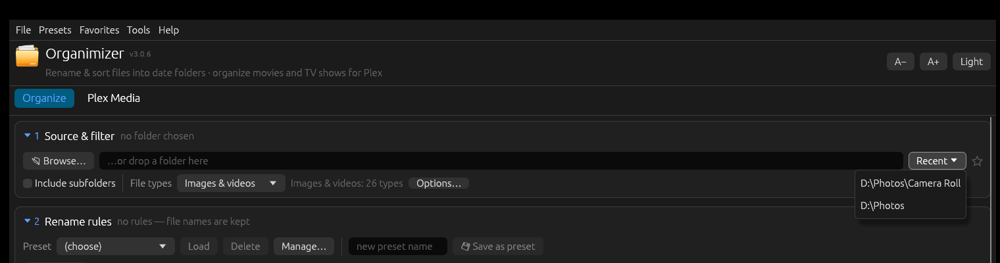

Pick a folder and the live preview shows what would happen. Nothing
changes until you click **Apply** and confirm.

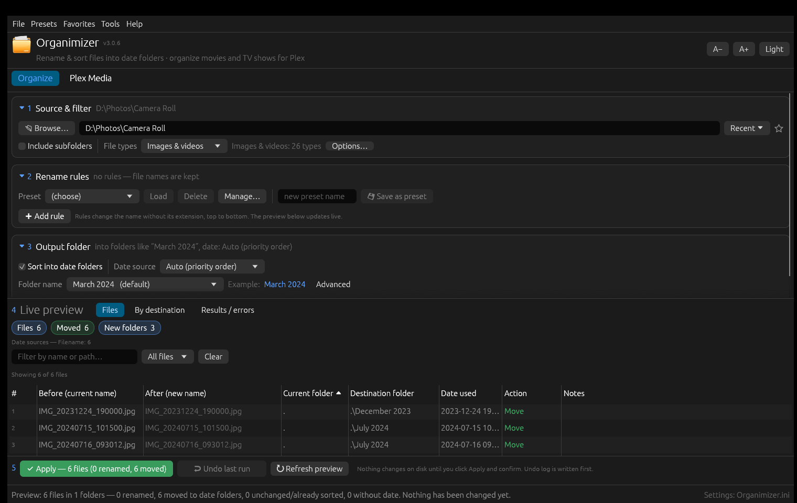

## Plex Media tab

1. **Source:** Browse, drop a folder, or pick one from **Recent**.
2. **Mode:** **Rename only** (default) or **Full sort**.
3. Click **Scan**, check the preview, then **Apply**.

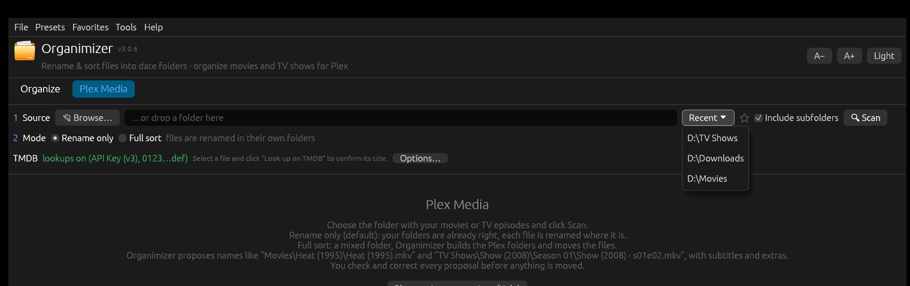

## Rename only (the default)

Use this when your folders are already right, for example
`The Expanse (2015)\Season 2\`. Each file is renamed **where it is**:
nothing moves and no folder is created. The show name, year and season
come from the folders the file is in.

**Folder name fixes** (`Season 2` -> `Season 02`, `Specials` ->
`Season 00`, adding the year) are separate rows above the file list and
are **unticked** by default. Tick only the ones you want; the Apply button
shows how many files and folders will change.

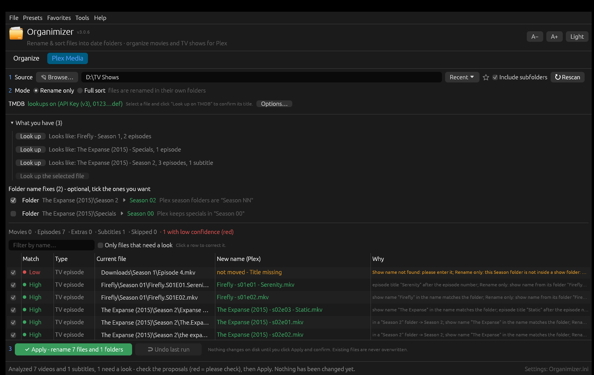

Rows whose folders do not look right are not guessed. Here
`Downloads\Season 1\Episode 4.mkv` is not inside a show folder, so it is
red and "not moved" until you type the show name (click the row to open
"Correct this file", or use Look up).

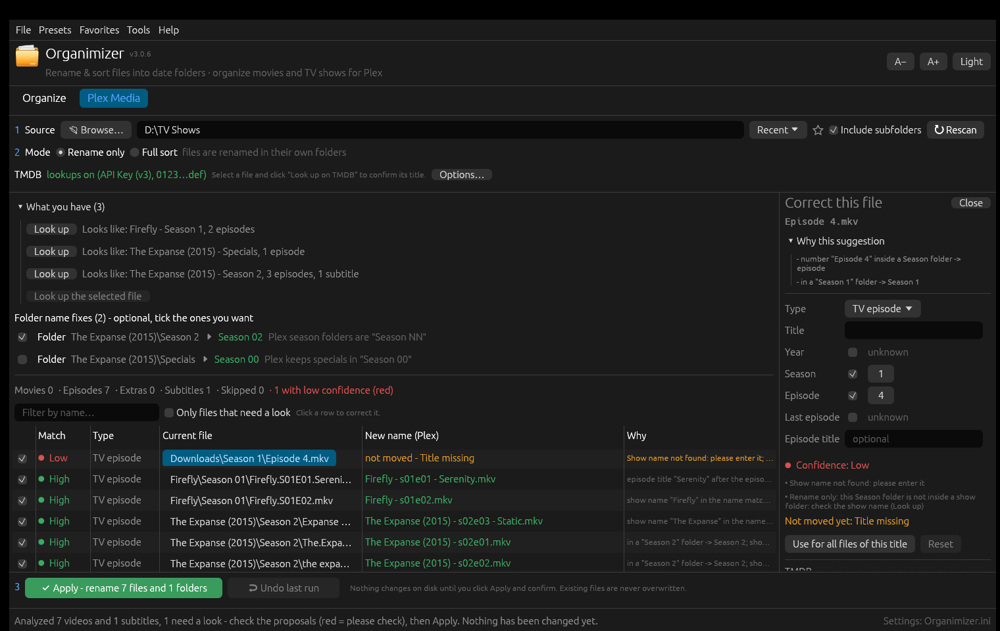

A show folder without a year (`Firefly`) is **not** a problem: the Why
column just notes that Plex folders are widely named
`Show Title (yyyy)`, and when the year is known an unticked fix offers to
add it.

## Full sort

Use this for a mixed folder of downloads or rips. Organimizer builds
`Show (Year)\Season NN\` and `Movie (Year)\` (with extras folders such as
`Trailers`) and moves the files into them.

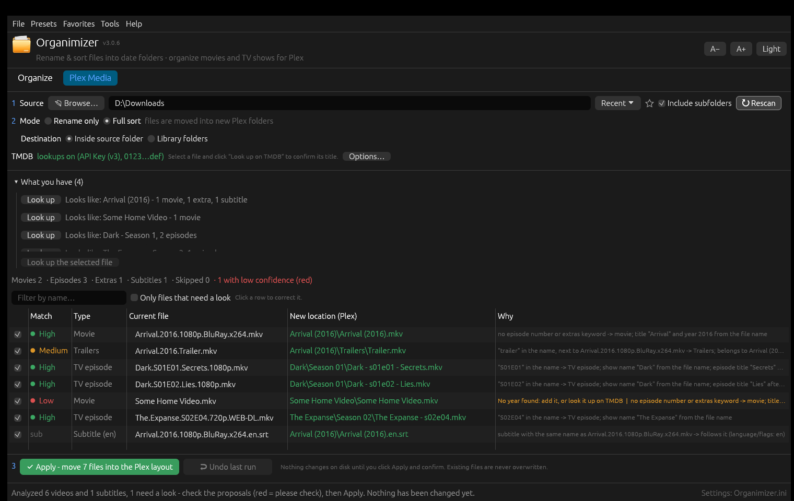

**Destination:** *Inside source folder* builds the folders inside the
chosen folder; *Library folders* moves movies to your Movies folder and
episodes to your TV shows folder.

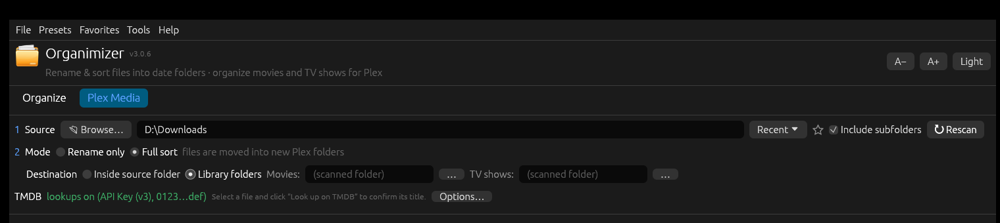

If you change the mode after a scan, click **Rescan**.

## Look up and type the title

With your own free TMDB key (Tools > Options > TMDB), **Look up** confirms
titles. When Organimizer is not sure (Medium or Low), or TMDB finds
nothing, it asks you to type the name and an optional 4-digit year first.

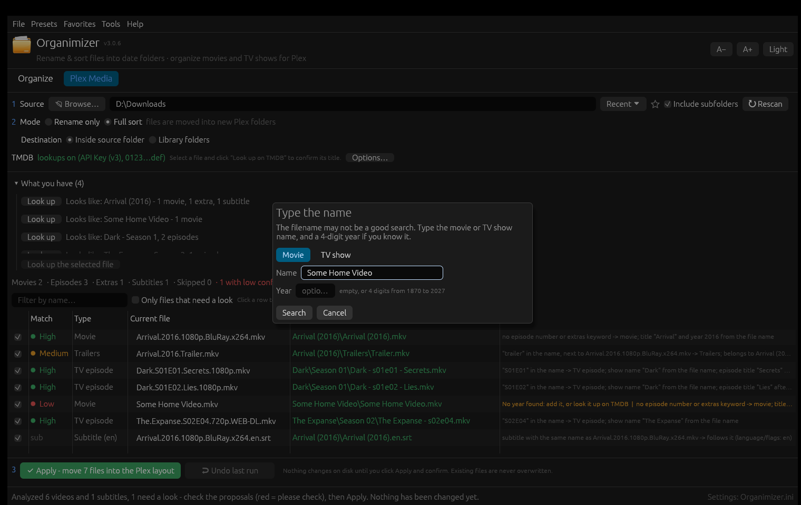

## Apply and Undo

Apply asks first. Existing files and folders are never overwritten, and an
undo log is written before anything changes.

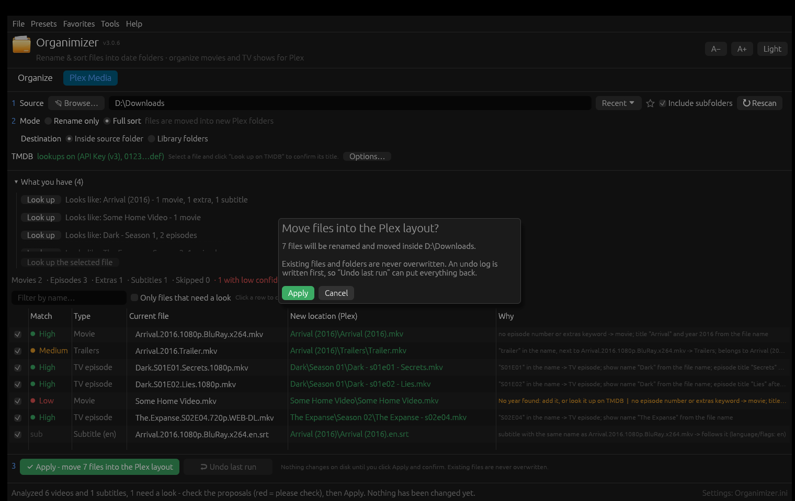

**Undo last run** puts every file (and, in Rename only, every renamed
folder) back.

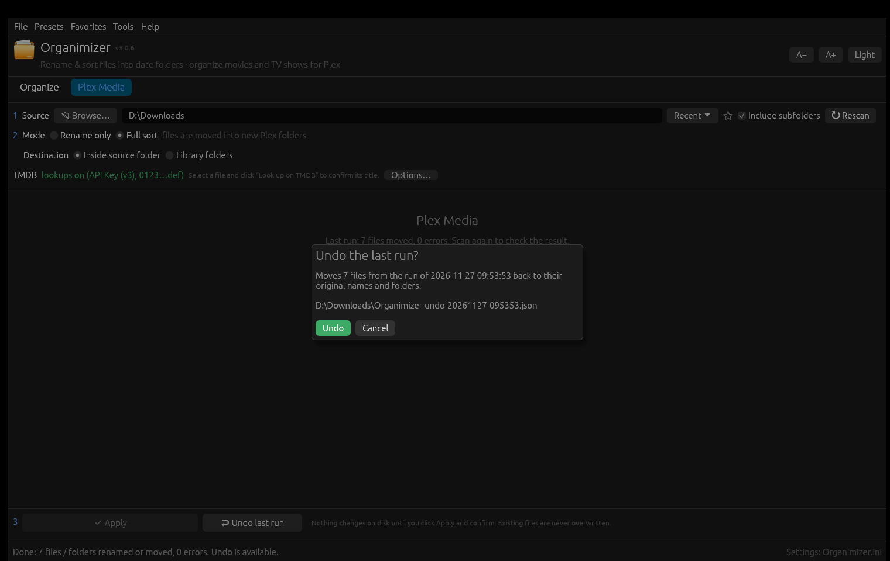

## Help (F1)

F1 opens `HELP.md` in Notepad. On the Plex tab, look for the "Plex tab"
chapter in the Contents line.

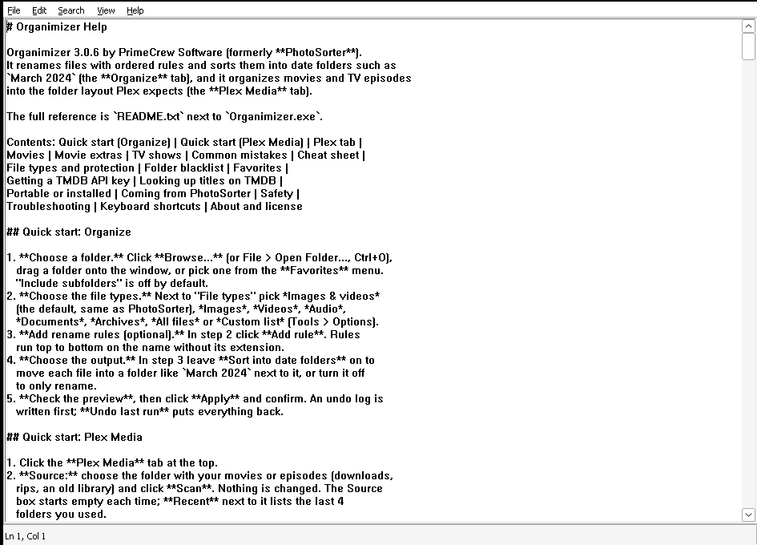

## Plex folder names in short

- Movies: `Movie Title (yyyy)\Movie Title (yyyy).mkv`
- TV: `Show Title (yyyy)\Season 01\Show Title (yyyy) - s01e02.mkv`
  (specials in `Season 00`)
- Show folders are widely named **`Show Title (yyyy)`**, movie folders
  **`Movie Title (yyyy)`**.
- Extras folders: `Behind The Scenes`, `Deleted Scenes`, `Featurettes`,
  `Interviews`, `Scenes`, `Shorts`, `Trailers`, `Other`.

The complete rules, with links to Plex's own support articles, are in the
"Plex tab" chapter of [HELP.md](../../dist/v3.0.6/HELP.md).
